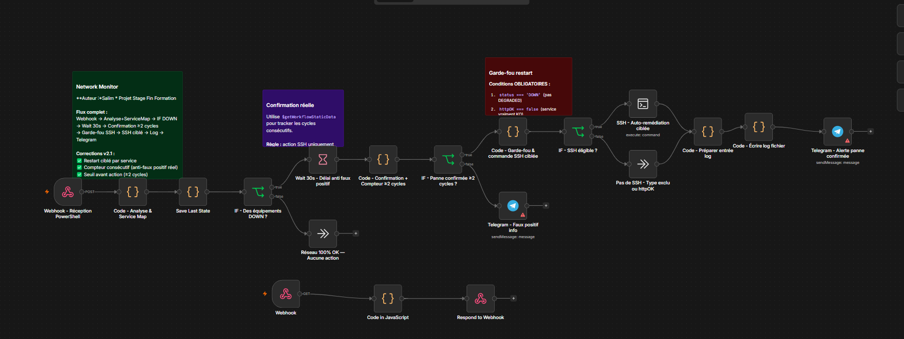
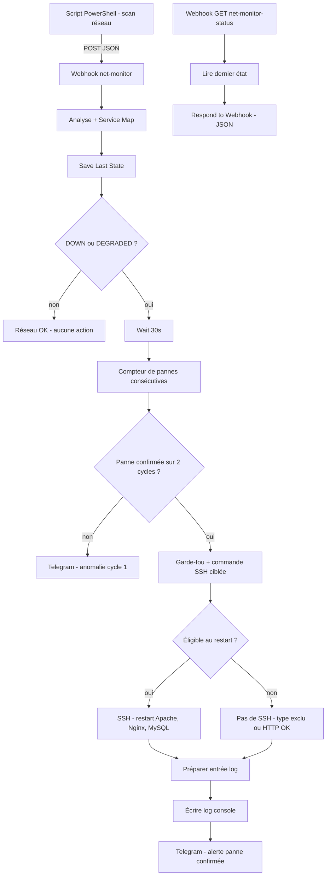

# Network Monitor - Auto-remédiation SSH & alertes Telegram

Workflow **n8n** de supervision réseau avec **auto-remédiation** : il reçoit l'état des équipements envoyé par un script PowerShell, confirme les pannes sur plusieurs cycles pour éviter les faux positifs, **redémarre automatiquement les services en panne** (Apache, Nginx, MySQL) par SSH, puis envoie un rapport détaillé sur **Telegram**.

Projet de fin de formation : Technicien Spécialisé en Systèmes et Réseaux.

## Aperçu



## Fonctionnalités

- Script PowerShell de scan (ping, port TCP, HTTP) planifiable toutes les 5 minutes
- Réception de l'état du réseau via webhook
- Enrichissement par une **Service Map** : type d'équipement, criticité, commande de remédiation
- **Anti faux positif** : une panne n'est confirmée qu'après 2 cycles consécutifs
- **Garde-fou déterministe** (règles heuristiques, pas d'IA) : restart uniquement si le service HTTP est réellement KO
- **Équipements exclus** : routeurs, switchs, points d'accès, DNS ne sont jamais redémarrés automatiquement
- **Remédiation ciblée** par SSH : diagnostic disque/RAM, puis restart d'Apache2, Nginx, MySQL seulement s'ils sont arrêtés
- Alertes Telegram (anomalie, panne confirmée avec résultat SSH, y compris en cas d'échec SSH)
- Endpoint de statut JSON pour alimenter un tableau de bord

## Architecture



## Stack

| Brique | Rôle |
|---|---|
| n8n | Orchestration |
| PowerShell | Collecte de l'état du réseau (ping, port, HTTP) |
| SSH | Remédiation sur le serveur Linux |
| Telegram | Notifications |
| VMware | Serveur web de test (Linux, Apache, Nginx) |

## Démarrage rapide

1. Préparer la VM Linux (SSH + droits `sudo` limités) : voir [docs/installation.md](docs/installation.md)
2. Créer un bot Telegram et récupérer le `chat_id`
3. Importer `workflow.json` dans n8n et connecter les credentials SSH et Telegram
4. Adapter la `serviceMap` (IPs, noms) dans le nœud `Code - Analyse & Service Map`
5. **Activer** le workflow (le compteur de pannes ne fonctionne qu'en mode actif)
6. Configurer et planifier le scanner : voir [docs/powershell-scanner.md](docs/powershell-scanner.md)
7. Tester avec les payloads de [docs/payload-format.md](docs/payload-format.md)

## Documentation

- [Installation et configuration](docs/installation.md)
- [Scanner PowerShell](docs/powershell-scanner.md)
- [Format des données et tests](docs/payload-format.md)
- [Logique du garde-fou](docs/safeguards.md)
- [Description de chaque nœud](docs/nodes.md)
- [Limites connues et roadmap](docs/limitations-and-roadmap.md)

## Structure du repo

```
.
├── workflow.json
├── README.md
├── .gitignore
├── LICENSE
├── scripts/
│   └── net-scan.ps1
├── examples/
│   └── sample-payload.json
├── docs/
│   ├── installation.md
│   ├── powershell-scanner.md
│   ├── payload-format.md
│   ├── safeguards.md
│   ├── nodes.md
│   └── limitations-and-roadmap.md
└── images/
    └── workflow.png
```

## Sécurité

- Aucun mot de passe, token ni URL privée dans le repo
- Les accès SSH et Telegram passent par les credentials n8n
- Le scanner lit l'URL du webhook et le token dans des variables d'environnement
- La remédiation repose sur un utilisateur SSH dédié avec `sudo` limité à 3 commandes (voir installation)
- Protège le webhook avec Header Auth avant toute exposition (voir [scanner PowerShell](docs/powershell-scanner.md))

## Auteur

Nombré Alidou Salim

## Licence

MIT
